# EduGrade

Electronic final-grade register for a college. Teachers enter final grades for their groups;
curators watch their own group; heads of department and the administration see analytics, students at risk
and Excel reports in one click. Built for and used at a college in Kazakhstan.


*All screenshots use a generated demo college; every name is fictional.*

## Contents

- [Roles](#roles)
- [Tour of the screens](#tour-of-the-screens)
- [Attestation periods](#attestation-periods)
- [Security](#security)
- [Stack](#stack)
- [Try it with demo data](#try-it-with-demo-data)
- [Real data](#real-data) · [Configuration](#configuration) · [Layout](#layout)

## Roles

| role | sees | can do |
|---|---|---|
| **Teacher** | only their own groups and subjects | enter final grades, export the register, get a hint when a student is one three away from a better result |
| **Curator** (a teacher assigned to a group) | everything a teacher sees, plus their group | check who has no final grades yet, download results for parents, edit the group roster |
| **Head of department** (a teacher with a department) | analytics, risk lists and group summaries of **their department** | no access to user management, passwords or the audit log |
| **Administrator** | the whole college | everything above, plus access control, roster reconciliation, user management and the audit log |

## Tour of the screens

The grading scale is 0–100 with automatic conversion: 90–100 → 5, 70–89 → 4, 50–69 → 3, below 50 → not certified,
«Н» → absent.

### Sign in

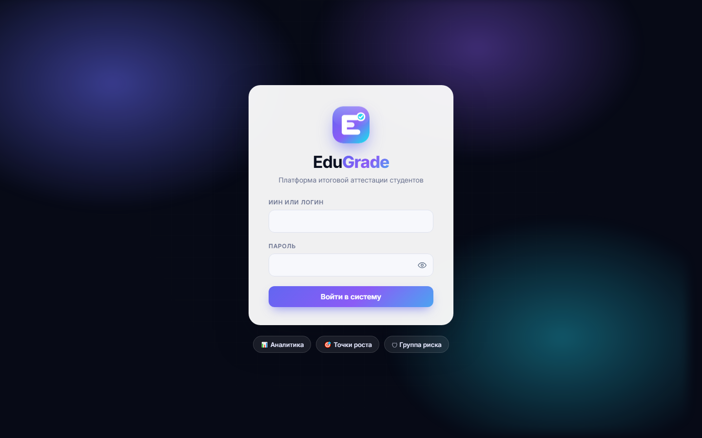

Sign-in by login or ID number. A temporary password has to be changed at the first login, and every password
field has a show/hide toggle. Failed attempts are rate-limited.

### Final register (*Итоговая ведомость*) — teachers


Pick a group and a subject, type a score from 0 to 100 (or «Н») next to each student and save. The grade (5 / 4 / 3 /
not certified) is calculated automatically. The header shows how many students are filled in and the distribution.
If a student is **one three away** from being a "good" student in this subject, the row is highlighted and the chips
above the table list such cases. *Excel* downloads the register.

### What's new window — everyone

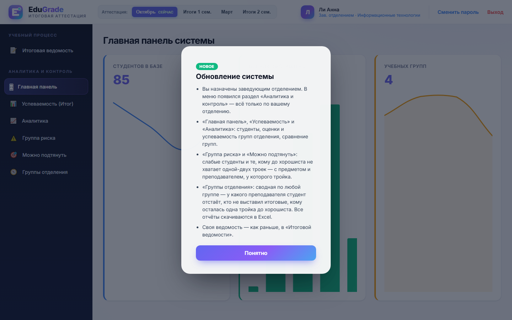

After an update every user sees a one-time window with the changes that matter **for their role** (here: a head of
department). The text lives in `backend/notify.py`; change `NEWS_VERSION` to show it again.

### Dashboard (*Главная панель*)

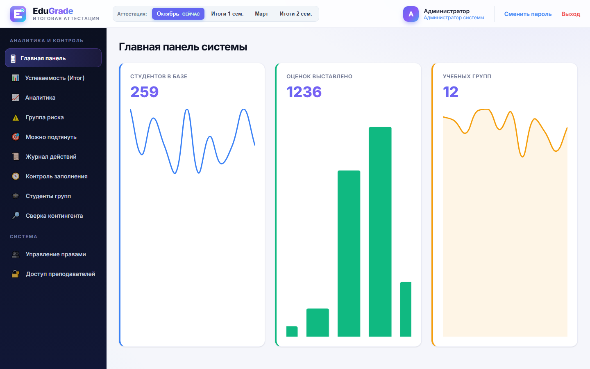

Students in the database, number of grades entered and number of groups, with small charts. For a head of department
the same page is limited to their department:

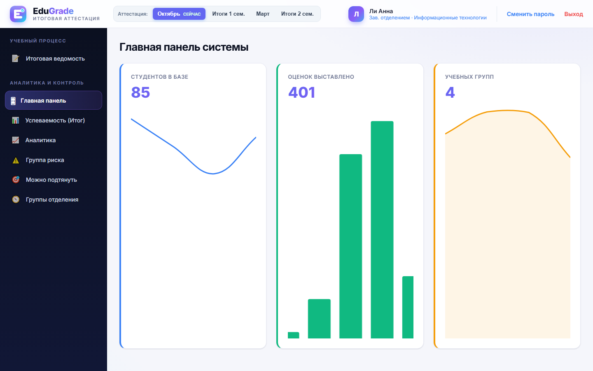

### Performance (*Успеваемость*)

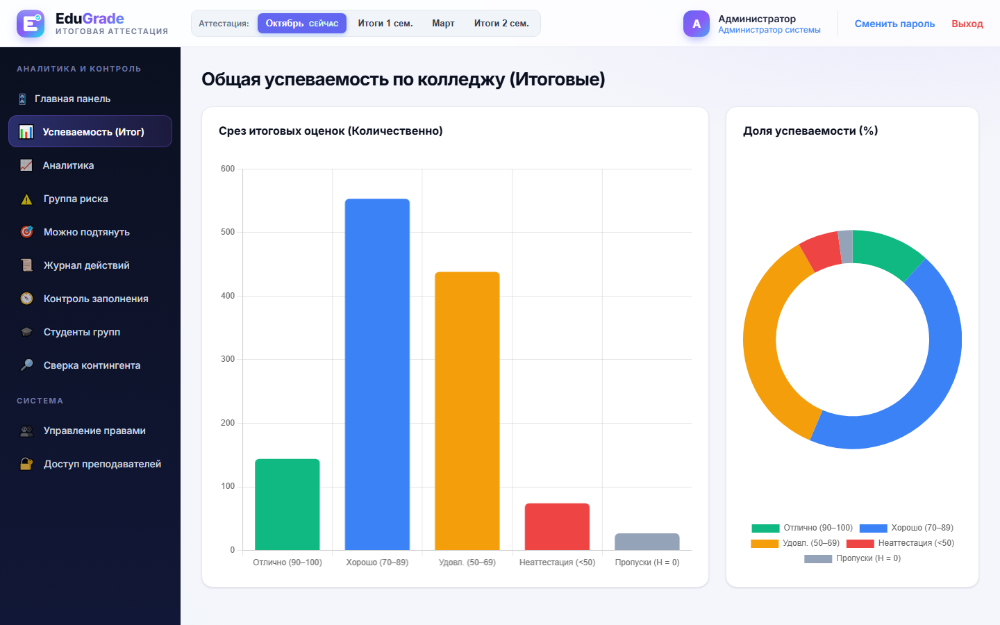

How the final grades are distributed across the college: counts per grade and the share of students per grade.

### Analytics (*Аналитика*)


Performance by department and by group, plus a side-by-side comparison of any groups. The comparison, or all groups,
downloads as Excel.

### At-risk (*Группа риска*)


- **Weak groups** — low average, many weak students or many "not certified";
- **Weak students**, by severity;
- **Dead souls** — students with no grades at all, plus those who are just suspicious;
- **Groups without data** — nobody has entered anything yet.

The thresholds are adjustable (*Пороги*); every list and the full report download as Excel.

### Can be pulled up (*Можно подтянуть*)

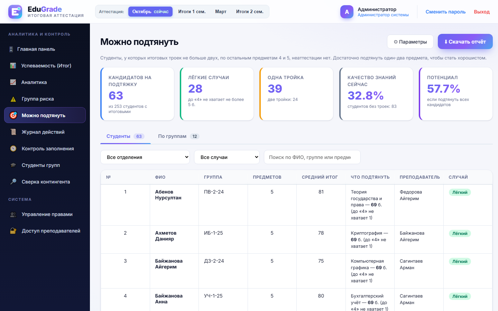

Students with one or two threes and nothing below, who become "good" students if one or two subjects are improved.
For every student the page shows which subject and which teacher, how many points are missing, and how easy the case is.
Also available **by group**, with the knowledge-quality metric and the potential gain.

### Completeness control (*Контроль заполнения*) — curators, heads, administration

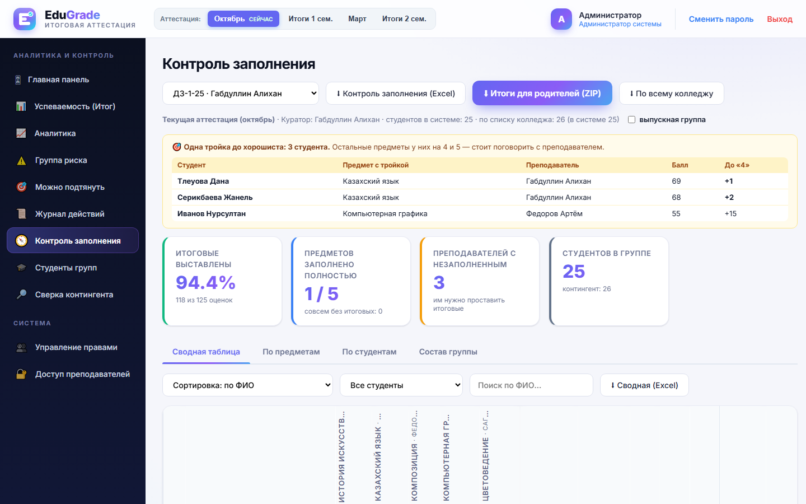

Pick a group: who has entered the finals and who has not, per subject and per teacher; students who are one three away
from a better result; the number of students against the official list. Four tabs: **summary table**, **by subject**,
**by student**, **roster**. Downloads: completeness (Excel), the summary table (Excel), a **ZIP of per-student results
for parents**, and the whole college (for the administration) or the whole department (for a head).
A group can be marked as **graduating**: its semester results count as the final attestation.

### Group roster (*Студенты групп*)

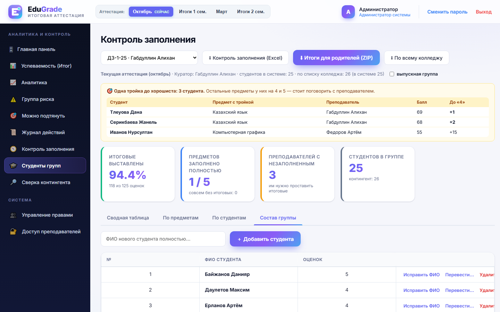

The roster tab of the same screen: add a student, correct a name, remove a student. Moving a student to another group
is left to the administrator. Curators get the same screen as *My group* (*Моя группа*).

### Roster reconciliation (*Сверка контингента*) — administration

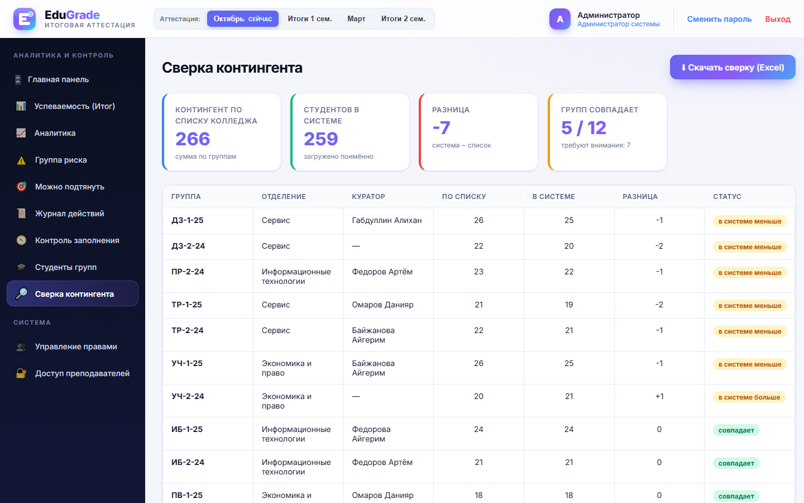

Compares the number of students loaded into the system with the official list of the college, group by group:
**matches**, **fewer in the system**, **more in the system**, **not in the list**. The result downloads as Excel.

### User management (*Управление правами*) — administration

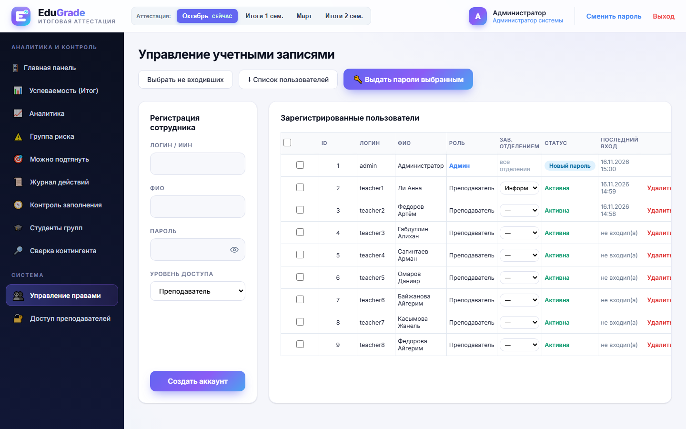

Create accounts, choose the access level, **appoint a head of department**, and **remove** an account.
*Select not logged in* + *Issue passwords to selected* creates temporary passwords and downloads an Excel file with the
logins and passwords; a teacher sets their own at the first login.

### Teacher access (*Доступ преподавателей*) — administration

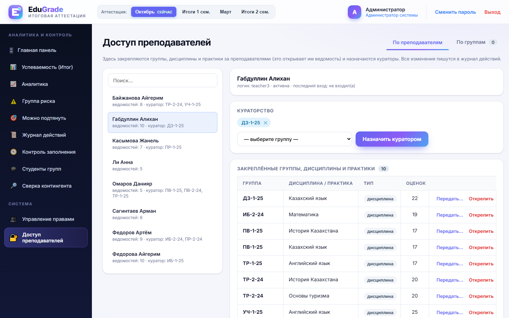

Pin a group and a subject to a teacher (this opens the register for them), create a **practice**, **hand a register over**
to another teacher, unpin, and **appoint a curator**. Work **by teacher** or **by group**. Every change goes to the audit log.

### Audit log (*Журнал действий*) — administration

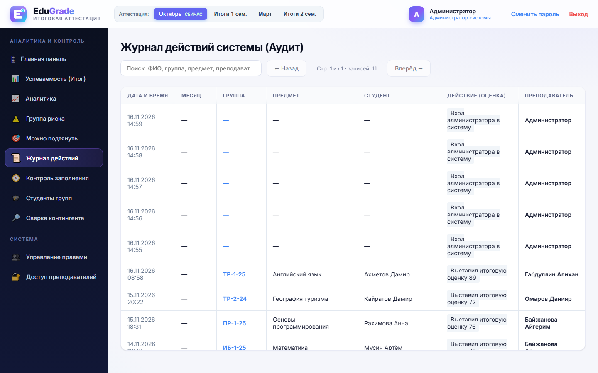

Who changed which grade and when, who logged in, who downloaded which report, who changed access. Searchable.

## Attestation periods

The strip at the top (*Аттестация*) switches the screens and reports between four periods:
**October**, **1st semester**, **March**, **2nd semester**. Administrators and curators can look at any period;
teachers always work in the current one (chosen by the calendar), whatever the request says.

## Security

- JWT sessions with revocation (a password change or block logs out every device), bcrypt hashes;
- forced password change on first login, login rate limiting, CORS and proxy settings via environment variables;
- a head of department can only reach their own department, on the server side as well as in the menu;
- every grade change, login, export and access change is written to the audit log.

## Stack

Backend: Python · FastAPI · SQLAlchemy · SQLite · python-jose · bcrypt · openpyxl
Frontend: plain HTML / CSS / JavaScript, no build step · Chart.js

## Try it with demo data

Requires Python 3.10+.

```bash
pip install -r backend/requirements.txt
python backend/demo_seed.py --fresh          # fictional college: 12 groups, ~260 students, 8 teachers
python backend/demo_fill.py --yes --dead 3   # demo grades, including a few "dead souls"
python run.py start
```

The site opens at http://127.0.0.1:5500 and the API runs on port 8000.
Log in as `admin` / `admin` (you'll be asked to change the password) or as `teacher1`…`teacher8` / `demo`.
In the demo `teacher1` is a head of department, most groups have a curator, the official-list counts differ from the
system in a few groups, and one group is a graduating one — so every screen above has something to show.

On Windows you can just double-click `start.bat`: it creates the environment, installs dependencies and opens a menu.

### Other `run.py` commands

| command | what it does |
|---|---|
| `python run.py` | interactive menu |
| `python run.py clear` | delete all grades and the audit log |
| `python run.py new` | recreate the database without grades |
| `python run.py demo` | fill in demo grades |

The database is backed up to `backups/` before any of them.

## Real data

Student lists (`backend/seed.py`, `backend/seed_students_fix.py`) and curricula (`backend/plans/*.xls[x]`)
contain personal data and are not in the repository, nor are the college's official lists.
With them in place, `python backend/setup_db.py --fresh` builds the production database.

## Configuration

Environment variables:

| variable | default | |
|---|---|---|
| `KKCI_SECRET_KEY` | generated into `backend/.secret_key` | token signing key |
| `KKCI_TOKEN_MINUTES` | `720` | session lifetime, minutes |
| `KKCI_ALLOWED_ORIGINS` | `*` | allowed CORS origins; set your domain in production |
| `KKCI_RATE_LIMIT` | `600` | requests per minute per IP |
| `KKCI_TRUST_PROXY` | `0` | `1` when running behind nginx |
| `KKCI_DEBUG` | `0` | `1` enables `/docs` |

## Layout

```
backend/    API, models, reports, periods, curator and access modules, database scripts
frontend/   page, styles and scripts
docs/       screenshots (generated from the demo college)
run.py      start and maintenance
start.bat   the same for Windows
```
