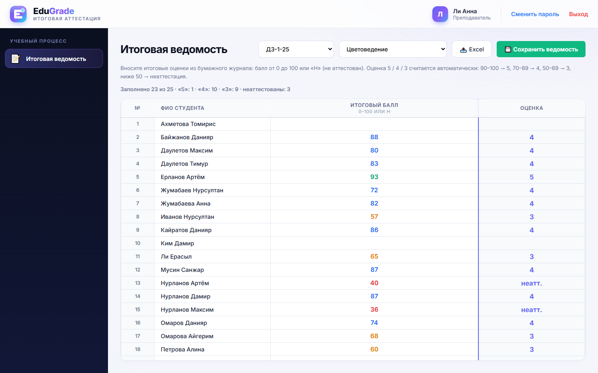
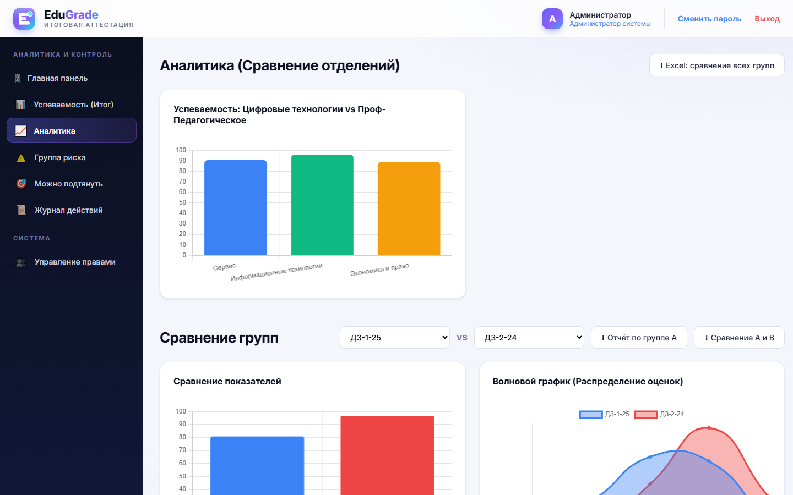
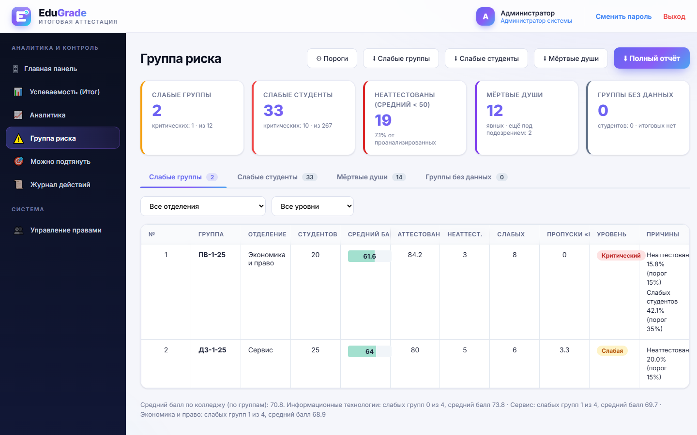

# EduGrade

Electronic final-grade register for a college. Teachers enter final grades for their groups;
the administration sees the whole college at once: analytics by department and group, students at risk,
and Excel reports in one click. Built for and used at a college in Kostanay, Kazakhstan.



*Screenshots use a generated demo college; all names are fictional.*

## What it does

**For teachers**
- log in and see only your own groups and subjects;
- 100-point scale with automatic conversion: 90–100 → 5, 70–89 → 4, 50–69 → 3, below 50 → not certified, «Н» → absent;
- export your register to Excel.

**For the administration**
- dashboard and per-department / per-group analytics, with side-by-side comparison of any two groups;
- **At-risk module**: weak groups and students with configurable thresholds, plus "dead souls": students with no grades at all;
- **Can be pulled up**: students one or two subjects away from a better result;
- Excel reports: group report, group comparison, college-wide comparison, risk lists;
- user management with password issuing, plus an audit log of every grade change.

**Security**
- JWT sessions with revocation (a password change or block logs out every device), bcrypt hashes;
- forced password change on first login, login rate limiting, CORS and proxy settings via environment variables.

| Analytics | At-risk students |
|---|---|
|  |  |

## Stack

Backend: Python · FastAPI · SQLAlchemy · SQLite · python-jose · bcrypt · openpyxl
Frontend: plain HTML / CSS / JavaScript, no build step · Chart.js

## Try it with demo data

Requires Python 3.10+.

```bash
pip install -r backend/requirements.txt
python backend/demo_seed.py --fresh          # fictional college: 12 groups, ~270 students, 8 teachers
python backend/demo_fill.py --yes --dead 3   # demo grades, including a few "dead souls"
python run.py start
```

The site opens at http://127.0.0.1:5500 and the API runs on port 8000.
Log in as `admin` / `admin` (you'll be asked to change the password) or as `teacher1`…`teacher8` / `demo`.

On Windows you can just double-click `start.bat`: it creates the environment, installs dependencies and opens a menu.

### Other `run.py` commands

| command | what it does |
|---|---|
| `python run.py` | interactive menu |
| `python run.py clear` | delete all grades and the audit log |
| `python run.py new` | recreate the database without grades |
| `python run.py demo` | fill in demo grades |

The database is backed up to `backups/` before any of them.

## Real data

Student lists (`backend/seed.py`, `backend/seed_students_fix.py`) and curricula (`backend/plans/*.xls[x]`)
contain personal data and are not in the repository. With them in place, `python backend/setup_db.py --fresh`
builds the production database.

## Configuration

Environment variables:

| variable | default | |
|---|---|---|
| `KKCI_SECRET_KEY` | generated into `backend/.secret_key` | token signing key |
| `KKCI_TOKEN_MINUTES` | `720` | session lifetime, minutes |
| `KKCI_ALLOWED_ORIGINS` | `*` | allowed CORS origins; set your domain in production |
| `KKCI_RATE_LIMIT` | `600` | requests per minute per IP |
| `KKCI_TRUST_PROXY` | `0` | `1` when running behind nginx |
| `KKCI_DEBUG` | `0` | `1` enables `/docs` |

## Layout

```
backend/    API, models, reports, database scripts
frontend/   page, styles and scripts
docs/       screenshots
run.py      start and maintenance
start.bat   the same for Windows
```
